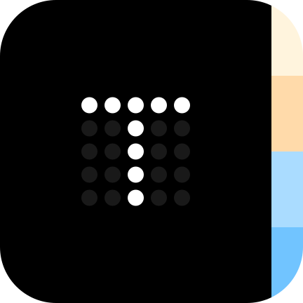
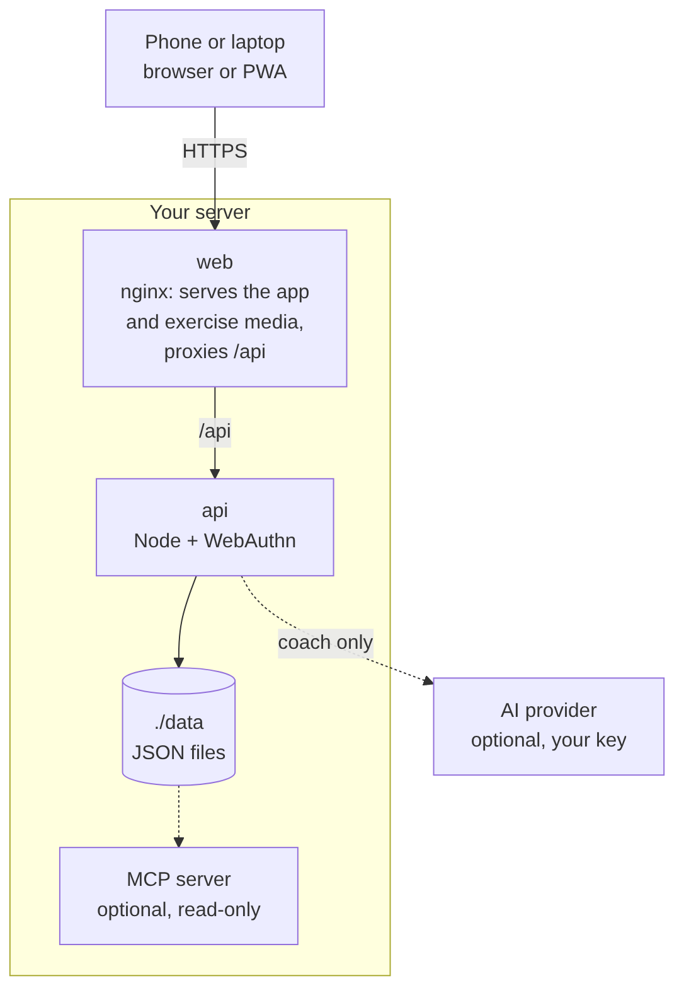
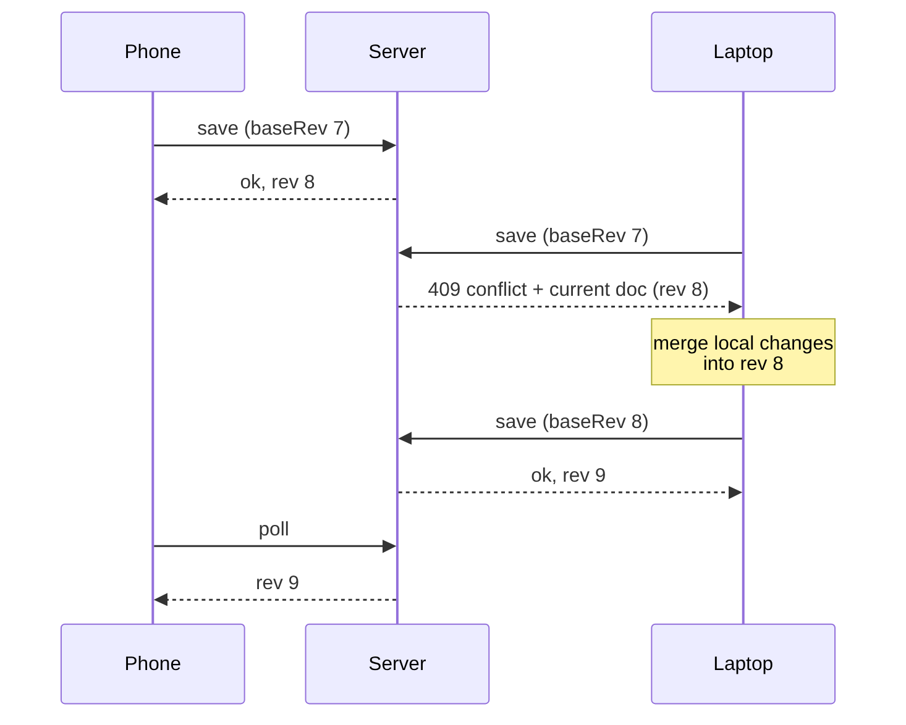

<div align="center">

<picture>
  <source media="(prefers-color-scheme: dark)" srcset="design/logo/tren-logo-light.svg">
  
</picture>

# Tren

**A free workout tracker for logging sets fast between rests.**

Self-hosted, offline-first, passkey sign-in, your data in a folder you own.<br>
A restyled fork of [openGym](https://github.com/DuarteSantos8/openGym).

[](https://github.com/deXter3738/tren/actions/workflows/test.yml)
[](LICENSE)

[Self-hosting guide](docs/SELF_HOSTING.md) ·
[Architecture](docs/ARCHITECTURE.md) ·
[Design handover](design/HANDOFF.md) ·
[Keeping up with openGym](docs/UPSTREAM.md)

</div>

## What Tren is

Tren is [openGym](https://github.com/DuarteSantos8/openGym) with a new face. openGym is a mature
self-hosted gym and body-weight tracker; Tren keeps its engine exactly as it is (the data model,
sync, offline logging, passkeys and the 5,632-exercise catalogue) and replaces how it looks and
reads: black-and-white surfaces, Inter, one round action button, and copy written for the forty
seconds you have between sets.

Everything visual comes from the handover pack in [`design/`](design/README.md), which is the
single source of truth for every colour, size, corner, timing and word.

| | openGym | Tren |
|---|---|---|
| Engine, sync, offline, passkeys | the original | unchanged, merged from upstream monthly |
| Look and copy | openGym's dark and lime theme | Tren's tokens, components and wording |
| Scope | everything, including phone apps and a watch app | v0.1 is the web app, English only |

Upstream's work keeps arriving: this repository carries openGym's full history and an update is a
plain merge, never a re-import. [docs/UPSTREAM.md](docs/UPSTREAM.md) records every upstream file
Tren has touched and why.

## Status

Tren v0.1 is being built screen by screen, in the order set by
[`design/HANDOFF.md`](design/HANDOFF.md). Until a screen is restyled it still looks like openGym,
in Tren's colours.

```
done   Tokens and Inter          every screen already shows Tren's colours, light and dark
done   Bottom bar                tab bar, round action button, Start bar morph
done   Global behaviours         the eight toasts and banners every screen shares
next   Home and Live workout     waiting on design boards 04, 05 and 06
later  Summary, History, Routines, Add exercise, the account screens, You, Admin
```

Screenshots land here as the screens are built. There is no release yet and no published image, so
there is nothing to install besides the source below.

## Quick start

You need [Docker](https://docs.docker.com/get-docker/) with Compose.

```bash
git clone https://github.com/deXter3738/tren
cd tren
cp .env.example .env
docker compose up -d --build
```

Open <http://localhost:8080>, create your profile, and you're in. The exercise animations are part
of the image, so there is nothing else to download.

> [!IMPORTANT]
> Always pass `--build`. The `image:` lines in `docker-compose.yml` still point at openGym's
> prebuilt images; without `--build`, Compose pulls openGym rather than building Tren. Tren
> publishes no images of its own yet.

To reach it from your phone with passkeys you need HTTPS on a domain, which is a two-line change
in `.env`. The [self-hosting guide](docs/SELF_HOSTING.md) walks through Cloudflare Tunnel, Caddy,
Traefik and nginx, and there are separate guides for [HTTPS on a LAN](docs/SELF_HOSTING_HTTPS.md),
[a Mac with Tailscale](docs/SELF_HOSTING_MAC.md) and [Kubernetes](docs/SELF_HOSTING_KUBERNETES.md).

<details>
<summary><b>Configuration reference</b> (all through <code>.env</code>)</summary>

Tren ships its own defaults in a block at the end of `.env.example`; where they differ from
openGym's, the Tren value is the one below.

| Variable | What it does | Default |
|---|---|---|
| `RP_ID` | Hostname passkeys are bound to | `localhost` |
| `ORIGIN` | Full URL the app is served from | `http://localhost:8080` |
| `WEB_PORT` | Host port for the web UI | `8080` |
| `NGINX_PORT` | Port the web container listens on inside the container | `80` |
| `BACKEND` | Name of the API service that `/api` is proxied to | `api` |
| `PORT` | Port the API listens on; the web container proxies to the same value | `3000` |
| `RP_NAME` | Name shown in the passkey prompt | `Tren` |
| `SESSION_DAYS` | How long a sign-in lasts, in days | `90` |
| `ADMIN_UIDS` | User ids that get the admin dashboard, comma-separated | *(none)* |
| `FIRST_USER_ADMIN` | `1`: the first profile created on an empty instance becomes its admin | `1` |
| `INVITE_ONLY` | Require an invite code to create a profile | *(off)* |
| `ALLOW_GUEST` | Offer "Continue without account"; `0` requires a profile | `0` |
| `PASSWORD_LOGIN` | Offer name-and-password sign-in next to passkeys | *(off)* |
| `TRUST_PROXY` | Let the sign-in throttle read the client address from proxy headers | `1` in `docker-compose.yml` |
| `AUDIT_LOG` | Record sign-ins and admin actions; `0` records nothing | *(on)* |
| `AUDIT_MAX` | Events kept in the activity log; `0` for no limit | `5000` |
| `AUDIT_DAYS` | Days kept in the activity log; `0` keeps until `AUDIT_MAX` | `90` |
| `AUDIT_IP` | Record the caller's address: `off`, `net` (network only) or `full` | `off` |
| `ALLOWED_PRIVATE_IPS` | Private addresses push endpoints may resolve to: comma-separated IPs, `a-b` ranges or CIDR blocks | *(none)* |
| `VAPID_SUBJECT` | Contact URL sent with push notifications | your `ORIGIN` |
| `COACH_DISABLED` | `1` forces the AI coach off instance-wide | `1` |

Push-notification keys are generated on first run into `./data/vapid.json`. `DATA_DIR` is pinned to
`/data` inside the container and mapped to `./data` on the host; change the volume, not the
variable. The [self-hosting guide](docs/SELF_HOSTING.md) covers every option in detail.

</details>

## What it does

The engine is openGym's, so everything it can do, Tren can do:

- **Plan.** A routine per weekday or a rotation, over 5,600 exercises with animated demos, four
  starter plans, supersets, warm-ups, drop sets, timed work and planned deloads. Your own
  exercises too, with your own photo or video.
- **Train.** Guided sessions that start themselves, weights pre-filled from last time, a rest
  timer between sets, PRs caught as you go, plate math, per-side reps, swipe to delete or copy a
  set.
- **Progress.** Progression rules per routine or exercise (linear, Greyskull LP, double, triple,
  time-based), estimated 1RM, a muscle map of volume and recovery, a year-long heatmap,
  body-weight charts and progress photos.
- **Own your data.** Passkeys with per-profile sync across devices, field-by-field merges so two
  devices never overwrite each other, imports from FitNotes, Strong, Hevy and Apple Health, and a
  one-file JSON export whenever you like.

openGym's [full feature list](https://github.com/DuarteSantos8/openGym#features) is the complete
account.

**Outside Tren v0.1:** the Android, iPhone and Apple Watch apps, the widgets, the MCP server, the
AI coach and the Helm, Kubernetes and Nix deploys. The code for them is still in this repository,
inherited from upstream, but Tren v0.1 does not design, test or ship them.

## How it works

<p align="center">
<picture>
  <source media="(prefers-color-scheme: dark)" srcset="docs/diagrams/architecture-dark.png">
  
</picture>
</p>

- **`frontend/`** is React 19 and Vite (React Router, Zustand), built to static files inside
  Docker. Tren's own code sits in `frontend/src/tren/` and `frontend/src/ui/tren/`.
- **`api/`** is plain `node:http` with three dependencies: `@simplewebauthn/server` for passkeys,
  `web-push` for notifications and `undici` for the AI coach's provider calls. Everything is
  stored as JSON under `./data`.
- **`web/`** builds the frontend and serves it with nginx, proxying `/api` so the whole app sits on
  one origin, which passkeys require.
- **`design/`** is the handover pack, read-only: tokens, components, boards and the build order.

The [architecture overview](docs/ARCHITECTURE.md) has the longer version with diagrams. The
training logic (progression rules, 1RM, how a logged session is read back) lives in pure functions
under `frontend/src/lib/` with tests beside them, and the HTTP API is documented in
[`api/openapi.yaml`](api/openapi.yaml).

### How sync works

Each profile's data is one document with a server revision. A device sends the revision it last
saw along with its changes; if another device wrote in between, the server refuses and returns the
current document so the device can merge and retry. Every change carries its own stamp, down to a
single setting or routine field, so the merge keeps the newest edit of each one and a deletion
stays deleted.

<p align="center">
<picture>
  <source media="(prefers-color-scheme: dark)" srcset="docs/diagrams/sync-dark.png">
  
</picture>
</p>

Nothing that hasn't reached the server is discarded on disconnect or sign-out, and the app shows a
banner whenever it's working offline.

### Your data

Everything lives in `./data` on your host:

| File | Contents |
|---|---|
| `db.json` | Profiles and public passkey data |
| `db.json.bak` | A copy of the last good `db.json`, used if the main file can't be read |
| `state-<user>.json` | Each user's plan, workouts, body weight and settings |
| `audit.log` | Admin activity log (no IP addresses unless you turn that on) |
| `secret` | Session-cookie signing key |

Back up `./data` and you've backed up everything. Passkey private keys never reach the server; they
stay in your phone's secure hardware or your password manager.

## Building Tren

```bash
cd frontend && npm install && npm run dev     # dev server, proxies /api to :3000
cd frontend && npm test                       # the frontend suite
cd api && npm test                            # the API suite
```

Before changing anything visual, read [`design/HANDOFF.md`](design/HANDOFF.md) and then
[`design/design-system/`](design/design-system/). The rules that matter most: restyle rather than
rebuild, use tokens rather than literal values, take the copy from the canvas word for word, and
match every empty, loading, offline and error state in both light and dark.
[`CLAUDE.md`](CLAUDE.md) is the short version of all of it.

## Documentation

The [documentation index](docs/README.md) sorts every guide by who it's for. The most used ones:

| I want to | Read |
|---|---|
| Set up my own instance | [Self-hosting](docs/SELF_HOSTING.md) |
| Understand the codebase | [Architecture](docs/ARCHITECTURE.md) |
| Build a Tren screen | [Design handover](design/HANDOFF.md) |
| Merge new work from openGym | [Keeping up with openGym](docs/UPSTREAM.md) |
| Bring my history from another app | [Importing data](docs/DATA_IMPORTS.md) |
| Get a quick answer | [FAQ](docs/FAQ.md) |
| Report a security problem | [Security](SECURITY.md) |

Guides inherited from openGym still say openGym where they describe upstream's own releases,
images and apps. That is deliberate: they document the engine Tren runs on.

## Credits and license

Tren exists because of **[openGym](https://github.com/DuarteSantos8/openGym)** by Duarte Santos and
its contributors. Every feature described above is their work; Tren restyles it. If you want the
original, with its phone apps, its Discord and its releases, go there.

**The code** is licensed under the [GNU AGPL v3.0](LICENSE), the same as openGym. You can
self-host, use, modify and share it; if you run a modified version as a network service, you have
to offer that version's source under the same license.

> [!IMPORTANT]
> **The exercise media is not covered by that license.** The stills and animations are
> © Aliaksandr Makatserchyk, [Gym visual](https://gymvisual.com/), licensed for use in openGym
> only: 180 px in this repository and on self-hosted servers. A non-commercial fork may keep them
> unmodified with the notice; anything else needs your own licence from gymvisual.com. They are
> never sent to an AI service.

Full third-party notices, including the body-diagram geometry, are in [NOTICE.md](NOTICE.md).
Contributions to openGym are signed off with its [Contributor License Agreement](CLA.md).

Tren's interface is built with [Claude Code](https://claude.com/claude-code), as openGym's is. A
person decides what ships, and the test suites are what keep the training logic honest.
